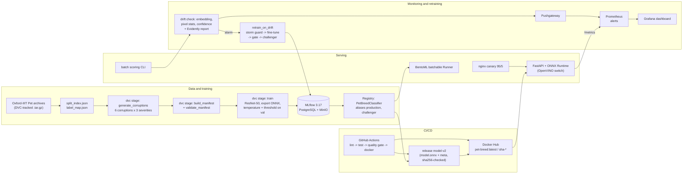

# Pet Breed Classifier

[](https://github.com/AbdelRahmanAlTamimi/Pet-Breed-Classification/actions/workflows/ci.yml)

Upload a photo of a cat or a dog and get back its breed, out of 37 breeds from the
Oxford-IIIT Pet dataset. The model's confidence is calibrated, so a reported 0.95 is
close to a real 95%. When the model is not confident enough it answers `"uncertain"`
instead of guessing, because a few of these breeds are genuinely hard to tell apart.

I built this as my final project for the MLOps Practitioner course (ITI × MLOps MENA).
The model is a fine-tuned ResNet-50. Most of the work went into the system around it:

- versioned data and a reproducible training pipeline (DVC)
- experiment tracking and a model registry (MLflow)
- CI with a quality gate that blocks a weaker model
- CPU serving with ONNX Runtime, plus a BentoML service and an nginx canary
- drift monitoring with Prometheus and Grafana
- a retraining loop that runs on drift but leaves the production decision to a human

## Try it

You need Docker with Compose v2. Clone the repo and `cd` into it first
(`git clone https://github.com/AbdelRahmanAlTamimi/Pet-Breed-Classification.git`), because
the second command uses its `docker-compose.yml`. Then run these three commands, with
`/path/to/pet.jpg` replaced by any cat or dog photo (JPEG or PNG, up to 10 MiB):

```bash
docker pull abdelrahmanaltamimi/pet-breed:latest
docker compose up -d
curl --retry 30 --retry-delay 1 --retry-all-errors -F "file=@/path/to/pet.jpg" http://localhost:8000/predict
```

The model ships inside the image, so nothing is built and nothing else is downloaded.
The image is linux/amd64; I have not tested it on ARM machines such as Apple Silicon.

This is a real response, for the validation image `Abyssinian_10.jpg`:

```json
{"breed":"Abyssinian","species":"cat","confidence":0.9793733225963039,
 "top_3":[{"breed":"Abyssinian","probability":0.9793733225963039},
          {"breed":"Egyptian_Mau","probability":0.006867481899213621},
          {"breed":"Russian_Blue","probability":0.00637048607088967}],
 "decision":"confident","model_version":"v2",
 "correlation_id":"5fb84e84-49e7-411c-8347-0e2cc45d7e3d","latency_ms":24.92}
```

The service has four other endpoints:

| Endpoint | What it does |
|---|---|
| `GET /health` | Returns `{"status":"healthy","model_version":"v2","num_classes":37}` |
| `GET /metadata` | Returns the temperature, the abstention threshold and the model's sha256 |
| `POST /predict/batch` | Classifies up to 32 files in one request |
| `GET /metrics` | Serves Prometheus metrics |

Stop the service with `docker compose down`.

## How it fits together



## Results

I chose the model on the validation set only, and I evaluated it on the test set
exactly once, after it was frozen. All latencies were measured on CPU (Intel Core i5-12500).

| What | Result | Details |
|---|---|---|
| Top-1 accuracy, val / test | 0.9497 / 0.9182 (val n=736, test n=3,669) | [results](docs/results.md#final-test-evaluation-one-shot-model-frozen) |
| Macro-F1, val / test | 0.9499 / 0.9173 | [results](docs/results.md#final-test-evaluation-one-shot-model-frozen) |
| Calibration error (ECE), val / test | 0.0321 / 0.0352 after temperature scaling (0.0568 on val before) | [calibration](docs/results.md#shipped-model-v2) |
| Abstention at threshold 0.918166: coverage / selective accuracy | val 0.8736 / 0.9813; test 0.8449 / 0.9739 (target 0.98) | [calibration](docs/results.md#shipped-model-v2) |
| `/predict` p95 under load (Locust, 50 users) | FastAPI 48 ms ([report](reports/locust_fastapi.html)), BentoML 110 ms ([report](reports/locust_bentoml.html)), 0 failures | [serving](docs/serving.md#serving-measurements-model-v2) |
| Inference engine p95 (batch 1, 6 threads) | ONNX Runtime 13.13 ms, OpenVINO FP32 17.57 ms | [runtimes](docs/serving.md#onnx-runtime-vs-openvino-cpu) |
| nginx canary at 95/5 | 1,000 requests split 940 / 60; rollback took 0.147 s, then 1,000 / 0 | [canary](docs/serving.md#serving-measurements-model-v2), [rollout stages](serving/README.md#nginx-canary) |
| CI quality gate | the build fails if val top-1 < baseline top-1 - 0.01 | [CI](docs/verification.md#data-versioning-and-ci) |
| Most reliable drift detector | pixel statistics: 0% false alarms on clean test images; it detects every corruption level except JPEG severity 1 (10%) | [scorecard](docs/monitoring.md#monitoring-and-drift-module-5) |
| Drift alert thresholds | pixel 2.4771, embedding AUC 0.5399, confidence KS 0.0977 | [detectors](docs/monitoring.md#monitoring-and-drift-module-5) |
| Drift-triggered retraining | run `ba7419ee` (2026-10-11): the candidate scored top-1 0.9470, within 0.01 of production's 0.9497, so it passed the gate | [retraining](docs/monitoring.md#retraining-loop) |
| Model registry | `production` = version 1 (the model being served); `challenger` = version 2, waiting for a human to approve it | [retraining](docs/monitoring.md#retraining-loop) |

## Decisions I made

- **Abstain instead of guessing.** The most confused test pairs are look-alike breeds,
  for example American Pit Bull Terrier vs Staffordshire Bull Terrier. Below the
  threshold the API answers `"uncertain"`. On test that leaves 84% of photos answered,
  with 97.4% of those correct.
- **ONNX Runtime on CPU.** I also served the model with BentoML's batching Runner and
  measured it. At this load it was slower (p95 110 ms vs 48 ms), because waiting to
  fill a batch adds queueing time and 50 users do not send enough concurrent requests
  to make up for it. OpenVINO FP32 was also slower than ONNX Runtime on this CPU.
- **A human approves production.** The retraining loop can promote a model to
  `challenger`, never to `production`. Its first triggered candidate passed the gate,
  but it was slightly weaker on val and came from uncommitted code, so I kept it
  waiting rather than ship it.
- **Measure drift detectors against ground truth.** I generated 6 corruptions × 3
  severities of the test images and scored each detector on them, including how often
  it fires on clean data. That showed that the cheap pixel-statistics detector is the
  one to trust here. The embedding detector false-alarms far too often.

## Screenshots

MLflow comparison of the model-selection runs, the final run and the retraining run
([model selection](docs/results.md#mlflow-runs-and-model-selection)):


Grafana on 2026-10-13, last 30 minutes. Live `/predict` traffic stays at a p95 of about
50-70 ms, far below the 0.5 s alert line. A pushed batch of `brightness_down` severity-3
images then raised all three drift scores above their thresholds, so all three alarms
fired ([details](docs/monitoring.md#monitoring-and-drift-module-5)):


## Reproduce it from scratch

You need uv, DVC (`uv tool install dvc`), Docker Compose v2, a logged-in `gh` CLI, a GPU
for training, and about 4.4 GB of disk for the data. The DVC remote is public over
HTTP, so no credentials are needed. Run `dvc` directly, since its stages call `uv run`.
`dvc repro` runs with MLflow tracking turned off.

```bash
uv sync
dvc pull data/raw/annotations.tar.gz.dvc data/raw/images.tar.gz.dvc
(cd data/raw && tar xzf images.tar.gz && tar xzf annotations.tar.gz)
dvc pull      # the rest of the data; if r2.dev throttles it, continue anyway
dvc repro     # rebuilds whatever is missing; after a full pull nothing is stale
```

The public `r2.dev` remote is rate-limited, so a full pull of the 66,042 corrupted
images may be throttled. If DVC is not an option, you can rebuild everything from the
official archives: [data/README.md](data/README.md) has the URLs and md5 checksums.

To run the MLflow stack (UI on `127.0.0.1:5000`; set real passwords in `docker/.env`
before using it for anything beyond a local test):

```bash
cp docker/.env.example docker/.env
docker compose -f docker/docker-compose.mlflow.yml up -d
```

To build the serving image from the released model:

```bash
mkdir -p artifacts
gh release download model-v2 --pattern model.onnx --pattern model_meta.json --dir artifacts
sha256sum --check ci/model_sha256.txt
docker build -t pet-breed .
```

Every other command (BentoML, Locust, monitoring, batch scoring) is in
[docs/verification.md](docs/verification.md#reproduce).

## Repository layout

```text
.
├── Dockerfile, docker-compose.yml       # serving image, quickstart compose file
├── dvc.yaml, dvc.lock, params.yaml      # DVC pipeline, lock file, training params
├── pyproject.toml, uv.lock              # package metadata, pinned dependencies
├── .github/workflows/ci.yml             # lint -> test -> quality gate -> docker
├── ci/model_sha256.txt                  # sha256 of the released model files
├── data/
│   ├── README.md                        # dvc pull, corruption suite, archive fallback
│   ├── label_map.json                   # 37 breeds, sorted alphabetically
│   ├── split_index.json                 # train / val / test split, seed 42
│   └── raw/                             # DVC pointers to the two dataset archives
├── docker/
│   ├── docker-compose.{mlflow,monitoring,canary}.yml  # MLflow, monitoring, canary stacks
│   └── Dockerfile.mlflow, .env.example  # MLflow server image, env template
├── docs/
│   ├── results.md, serving.md           # model results; serving and runtime measurements
│   ├── monitoring.md, verification.md   # drift and retraining; DVC/CI checks, all commands
│   └── status.md, project_spec.md       # course checklist and full changelog; project spec
├── loadtest/locustfile.py               # Locust workload
├── monitoring/
│   ├── features.py, reference.py        # per-image features, clean reference sets
│   ├── detectors.py, thresholds.py, scorecard.py  # detectors, thresholds, scorecard
│   ├── drift_check.py, retrain_on_drift.py  # per-batch drift check; guarded retraining
│   └── grafana/, prometheus/            # provisioned dashboard, scrape config, alerts
├── notebooks/train_resnet50.ipynb       # first training notebook
├── reports/
│   ├── metrics.json, baseline_metrics.json      # val metrics, CI baseline
│   ├── final_test_evaluation.json, robustness.csv  # one-shot test results
│   ├── drift_scorecard.csv, drift/      # detector scorecard, drift-check outputs
│   ├── locust_*.html                    # Locust reports
│   └── *.png                            # calibration, confusion matrix, screenshots
├── scripts/quality_gate.py              # CI quality gate
├── serving/
│   ├── service.py, import_model.py      # BentoML service, model import
│   └── nginx/, rollback.sh, README.md    # canary config, rollback, rollout stages
├── src/pet_breed_classification/        # package: data, training, predictor, API, batch, registry
└── tests/                               # pytest suite
```

## Limitations and what I would do next

The explanations behind each point are in [docs/status.md](docs/status.md#known-limitations).

- **Accuracy under heavy corruption.** On test, selective accuracy at the chosen
  threshold is 0.974, just under the 0.98 target. It drops to 0.83-0.92 for
  severity-3 downscaling, blur and JPEG. Next: fine-tune on corrupted training images
  and measure the result on the corruption suite.
- **The embedding drift detector** false-alarms on 80% of clean test batches (20% with
  a validation-set reference that I added afterwards). Pixel statistics is the alarm
  I rely on.
- **Retraining is not orchestrated.** It is a guarded Python call from the batch drift
  check, not an Airflow DAG.
- **No model optimization.** Pruning, quantization, distillation and TensorRT are not
  done yet.
- **The canary only tests the mechanics.** Both backends run the same image, and rollback
  is manual: there is no automatic rollback on latency.
- **Local tracking.** MLflow runs on my machine, so the screenshot above is the public
  record of the runs.
- **Load-test setup.** Locust ran on the same machine as the services, so the client
  competed with them for CPU.

## Project timeline

The project was built in five stages, one per course module.

| Stage | What was built | Key commits |
|---|---|---|
| 1. Packaging, API, Docker | dataset split, corruption suite, manifest, ResNet-50, FastAPI, Docker image, tests | `63ddec9`, PR #2 `cca208b` |
| 2. MLflow, DVC, CI | MLflow stack, calibration and abstention, 3 backbones compared, registry, DVC pipeline, CI quality gate, public DVC remote on R2 | `548b1db`, `e30a0c1`, `a16e7db` |
| 3. Serving | BentoML batchable Runner, Locust load tests, batch scoring, nginx canary | `9d5bd4a`, `cafa030` |
| 4. Evaluation and CPU runtimes | one-shot test evaluation, robustness table, OpenVINO benchmark | `78bea08`, `aab2b8d` |
| 5. Monitoring and retraining | drift detectors and scorecard, Prometheus and Grafana, drift-triggered retraining with a human-approved promotion | `15abeed`, `7a44650` |

The full changelog and the course checklist, with the evidence for each item, are in
[docs/status.md](docs/status.md).

## Dataset and license

Oxford-IIIT Pet Dataset: O. M. Parkhi, A. Vedaldi, A. Zisserman and C. V. Jawahar,
"Cats and Dogs", IEEE Conference on Computer Vision and Pattern Recognition (CVPR),
2012. https://www.robots.ox.ac.uk/~vgg/data/pets/. According to the dataset page
(checked 2026-10-13): "The dataset is available to download for commercial/research
purposes under a Creative Commons Attribution-ShareAlike 4.0 International License.
The copyright remains with the original owners of the images."
