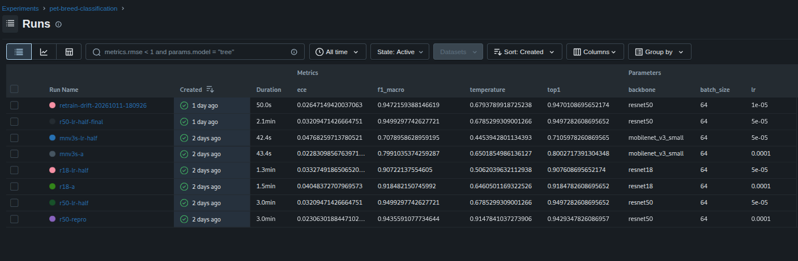
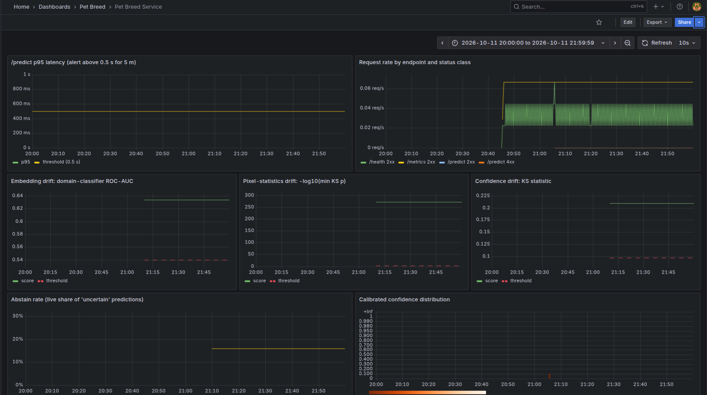

# Pet Breed Classifier

[](https://github.com/AbdelRahmanAlTamimi/Pet-Breed-Classification/actions/workflows/ci.yml)

A calibrated 37-breed classifier for user-submitted pet photos (Oxford-IIIT Pet), served
on CPU with ONNX Runtime. It returns the top-3 breeds with calibrated probabilities and
answers `"uncertain"` instead of guessing when the calibrated confidence is below the
abstention threshold. Around it: DVC-versioned data, MLflow tracking and registry, CI with
a quality gate, BentoML and nginx-canary serving, batch scoring, drift monitoring with
Prometheus and Grafana, and a drift-triggered retraining loop gated by a human.

## Quickstart

From a clone of this repository (Docker with Compose; the image is pulled from Docker Hub):

```bash
docker pull abdelrahmanaltamimi/pet-breed:latest
docker compose up -d
curl --retry 30 --retry-delay 1 --retry-all-errors -F "file=@/path/to/pet.jpg" http://localhost:8000/predict
```

Real response of model v2 for the val image `Abyssinian_10.jpg`:

```json
{"breed":"Abyssinian","species":"cat","confidence":0.9793733225963039,
 "top_3":[{"breed":"Abyssinian","probability":0.9793733225963039},
          {"breed":"Egyptian_Mau","probability":0.006867481899213621},
          {"breed":"Russian_Blue","probability":0.00637048607088967}],
 "decision":"confident","model_version":"v2",
 "correlation_id":"5fb84e84-49e7-411c-8347-0e2cc45d7e3d","latency_ms":24.92}
```

`GET /health` returns `{"status":"healthy","model_version":"v2","num_classes":37}`; `GET /metadata`
returns the temperature, threshold and sha256; `POST /predict/batch` takes up to 32 files;
`GET /metrics` serves Prometheus metrics. Stop with `docker compose down`.

## Architecture


## Results at a glance

| Metric | Value | Details |
|---|---|---|
| Top-1, val / test | 0.9497 / 0.9182 (val n=736, test n=3,669, test used once) | [results](docs/results.md#final-test-evaluation-one-shot-model-frozen) |
| Macro-F1, val / test | 0.9499 / 0.9173 | [results](docs/results.md#final-test-evaluation-one-shot-model-frozen) |
| ECE after temperature scaling, val / test | 0.0321 / 0.0352 (val before scaling: 0.0568) | [calibration](docs/results.md#shipped-model-v2) |
| Abstention threshold 0.918166: coverage / selective accuracy | val 0.8736 / 0.9813; test 0.8449 / 0.9739 (target 0.98) | [calibration](docs/results.md#shipped-model-v2) |
| Locust `/predict` p95, 50 users | FastAPI 48 ms ([report](reports/locust_fastapi.html)); BentoML 110 ms ([report](reports/locust_bentoml.html)); 0 failures | [serving](docs/serving.md#serving-measurements-model-v2) |
| Engine p95, batch 1, 6 threads | ONNX Runtime 13.13 ms; OpenVINO FP32 17.57 ms | [runtimes](docs/serving.md#onnx-runtime-vs-openvino-cpu) |
| nginx canary 95/5 | 1,000 requests: 940 stable / 60 canary; rollback 0.147 s, then 1,000 / 0 | [canary](docs/serving.md#serving-measurements-model-v2), [rollout stages](serving/README.md#nginx-canary) |
| CI quality gate | fails if val top-1 < baseline top-1 - 0.01 | [CI](docs/verification.md#data-versioning-and-ci) |
| Best drift detector | pixel statistics: 0% false alarms on clean test, detects every corruption level except JPEG severity 1 (10%) | [scorecard](docs/monitoring.md#monitoring-and-drift-module-5) |
| Drift alert threshold | `PetBreedDriftDetected` fires when a batch score exceeds its threshold: pixel 2.4771, embedding AUC 0.5399, confidence KS 0.0977 | [detectors](docs/monitoring.md#monitoring-and-drift-module-5) |
| Triggered retraining | run `ba7419ee` (2026-10-11): candidate top-1 0.9470 >= 0.9497 - 0.01, so it passed the gate | [retraining](docs/monitoring.md#retraining-loop) |
| Registry state | `production` = version 1 (the shipped model); `challenger` = version 2, `approval=pending` until a human approves | [retraining](docs/monitoring.md#retraining-loop) |

## Screenshots

MLflow comparison of the 6 selection runs, the final run and the retrain run
([model selection](docs/results.md#mlflow-runs-and-model-selection)):



Grafana, 2026-10-13, last 30 minutes: live `/predict` traffic with p95 at about 50-70 ms
(alert line 0.5 s), and a pushed `brightness_down` severity-3 batch whose three drift
scores exceed their thresholds, so all three alarms fire ([details](docs/monitoring.md#monitoring-and-drift-module-5)):



## Rubric status

| # | Area | Status | Evidence |
|---|---|---|---|
| 01 | Code & packaging | done | `pyproject.toml`, `src/`; [verification](docs/verification.md#final-verification) |
| 02 | API endpoint | done | `src/pet_breed_classification/api/`, `tests/test_api.py` |
| 03 | Docker | done | `Dockerfile`, `docker-compose.yml`; [Docker Hub check](docs/verification.md#docker-hub-image) |
| 04 | MLflow tracking | done | [model selection](docs/results.md#mlflow-runs-and-model-selection), [registry](docs/monitoring.md#retraining-loop) |
| 05 | DVC data versioning | done | `dvc.yaml`, `dvc.lock`, `data/README.md`; [DVC notes](docs/verification.md#data-versioning-and-ci) |
| 06 | GitHub Actions CI/CD | done | `.github/workflows/ci.yml`; [CI notes](docs/verification.md#data-versioning-and-ci) |
| 07 | Production serving | done | `serving/`; [serving](docs/serving.md) |
| 08 | Monitoring | done | `monitoring/`; [monitoring](docs/monitoring.md) |
| 09 | Peer review | not done (owner) | written by the owner, not part of this repository |
| 10 | README & architecture | done | this file |

Full evidence and both Track C checklists: [docs/status.md](docs/status.md).

## Reproduce

Needs uv, DVC (`uv tool install dvc`; public HTTP remote, no extra or credentials), Docker
Compose v2, a logged-in `gh` CLI, a GPU for training and disk for 4,352,746,975 bytes of DVC
data. Run `dvc` directly (stages call `uv run`); `dvc repro` runs with MLflow off. Fallback and
md5 values: [data/README.md](data/README.md); all commands: [docs/verification.md](docs/verification.md#reproduce).

```bash
uv sync
dvc pull data/raw/annotations.tar.gz.dvc data/raw/images.tar.gz.dvc
(cd data/raw && tar xzf images.tar.gz && tar xzf annotations.tar.gz)
dvc pull                                 # rest of the data; if r2.dev throttles it, go on anyway
dvc repro                                # rebuilds what is missing; after a full pull nothing should be stale
cp docker/.env.example docker/.env && docker compose -f docker/docker-compose.mlflow.yml up -d  # UI on 127.0.0.1:5000; set real passwords in docker/.env beyond a local test
mkdir -p artifacts && gh release download model-v2 --pattern model.onnx --pattern model_meta.json --dir artifacts && sha256sum --check ci/model_sha256.txt && docker build -t pet-breed .
```

## Repo tree

```text
.
├── Dockerfile, docker-compose.yml       # serving image, quickstart compose file
├── dvc.yaml, dvc.lock, params.yaml      # DVC pipeline, lock file, training params
├── pyproject.toml, uv.lock              # package metadata, pinned dependencies
├── .github/workflows/ci.yml             # lint -> test -> quality gate -> docker
├── ci/model_sha256.txt                  # sha256 of the released model files
├── data/
│   ├── README.md                        # dvc pull, corruption suite, archive fallback
│   ├── label_map.json                   # 37 breeds, sorted alphabetically
│   ├── split_index.json                 # train / val / test split, seed 42
│   └── raw/                             # DVC pointers to the two dataset archives
├── docker/
│   ├── docker-compose.{mlflow,monitoring,canary}.yml  # MLflow, monitoring, canary stacks
│   └── Dockerfile.mlflow, .env.example  # MLflow server image, env template
├── docs/
│   ├── results.md, serving.md           # model results; serving and runtime measurements
│   ├── monitoring.md, verification.md   # drift and retraining; DVC/CI checks, all commands
│   └── status.md, project_spec.md       # full rubric evidence and changelog; course handbook
├── loadtest/locustfile.py               # Locust workload
├── monitoring/
│   ├── features.py, reference.py        # per-image features, clean reference sets
│   ├── detectors.py, thresholds.py, scorecard.py  # detectors, thresholds, scorecard
│   ├── drift_check.py, retrain_on_drift.py  # per-batch drift check; guarded retraining
│   └── grafana/, prometheus/            # provisioned dashboard, scrape config, alerts
├── notebooks/train_resnet50.ipynb       # first training notebook
├── reports/
│   ├── metrics.json, baseline_metrics.json      # val metrics, CI baseline
│   ├── final_test_evaluation.json, robustness.csv  # one-shot test results
│   ├── drift_scorecard.csv, drift/      # detector scorecard, drift-check outputs
│   ├── locust_*.html                    # Locust reports
│   └── *.png                            # calibration, confusion matrix, screenshots
├── scripts/quality_gate.py              # CI quality gate
├── serving/
│   ├── service.py, import_model.py      # BentoML service, model import
│   └── nginx/, rollback.sh, README.md    # canary config, rollback, rollout stages
├── src/pet_breed_classification/        # package: data, training, predictor, API, batch, registry
└── tests/                               # pytest suite
```

## Known limitations

Explanations: [docs/status.md](docs/status.md#known-limitations).

- No Airflow: retraining is a guarded Python call from the batch drift check, not a DAG.
- Optimization (pruning, quantization, distillation, TensorRT) is out of scope by owner decision.
- MLflow runs locally on 127.0.0.1, so reviewers cannot open the owner's UI.
- The public `r2.dev` DVC remote is rate-limited; a full pull of the 66,042 corrupted images may be throttled.
- The embedding drift detector false-alarms on 80% of clean test batches (post-hoc val-reference variant: 20%).
- Test selective accuracy is 0.974, below the 0.98 target, and 0.83-0.92 under severity-3 downscale, blur and JPEG.
- Both canary backends run the same v2 image, and there is no automatic latency-based rollback.
- Locust shared the host with the services, and the Docker Hub image is linux/amd64 only.

## Session changelog

| Module | What landed | Key commits |
|---|---|---|
| 1. Packaging, API, Docker | dataset split, corruption suite, manifest, ResNet-50, FastAPI, Docker image, tests | `63ddec9`, PR #2 `cca208b` |
| 2. MLflow, DVC, CI | MLflow stack, calibration and abstention, 3 backbones, registry, DVC train stage, CI quality gate; public DVC remote on R2 (2026-10-13) | `548b1db`, `e30a0c1`, `a16e7db` |
| 3. Serving | BentoML batchable Runner, Locust, batch scoring, nginx canary | `9d5bd4a`, `cafa030` |
| 4. Evaluation and CPU runtimes | one-shot test evaluation, robustness, OpenVINO benchmark | `78bea08`, `aab2b8d` |
| 5. Monitoring and retraining | drift detectors, scorecard, Prometheus/Grafana, drift-triggered retraining; gate sets `challenger` only (2026-10-13) | `15abeed`, `7a44650` |

Full changelog with every commit: [docs/status.md](docs/status.md#session-changelog).

## Dataset and license

Oxford-IIIT Pet Dataset: O. M. Parkhi, A. Vedaldi, A. Zisserman and C. V. Jawahar,
"Cats and Dogs", IEEE Conference on Computer Vision and Pattern Recognition (CVPR),
2012. https://www.robots.ox.ac.uk/~vgg/data/pets/. The dataset page (checked on
2026-10-13) states: "The dataset is available to download for commercial/research
purposes under a Creative Commons Attribution-ShareAlike 4.0 International License.
The copyright remains with the original owners of the images."
